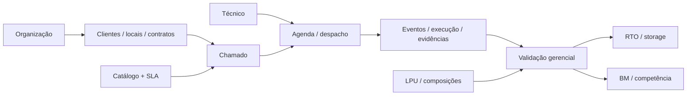

# Inventário e mapa do sistema

## Stack e estrutura

O repositório usa Next.js App Router com `src/app/(portal)` para o portal autenticado e `src/app/demo` para experiências demonstrativas. Há 69 rotas API, 192 migrations Supabase, 197 arquivos em `src/domain`/`src/lib` e 151 arquivos de teste (contagens verificadas por inventário do repositório).

## Mapa funcional

| Família | Rotas principais | Usuário | Entidades produzidas/consumidas | Situação |
|---|---|---|---|---|
| Identidade e administração | `/login`, `/portal/users`, `/portal/organizations`, `/portal/settings` | Owner/Admin | auth, organizations, memberships | Funcional parcialmente validada |
| Chamados | `/portal/tickets`, `/portal/tickets/[id]` | Operações/Gestor | tickets, solicitante, cliente, contrato, local | Funcional com E2E pendente |
| Field Service | `/portal/field-service`, `/portal/scheduling`, `/portal/routes`, `/portal/field` | Supervisor/Técnico | schedules, technicians, events, execution, completion | Parcial; exige homologação operacional |
| Validação/RTO | `/portal/review`, `/portal/field-service-reports` | Gestor | reviews, LPU, RTO, storage | Parcial; download/storage precisa prova |
| LPU | `/portal/settings/field-service/lpu` | Admin/Financeiro | lpu_items, compositions, lines | Implementado em API; UX e staging recentemente alinhados |
| Financeiro/BM | `/portal/field-service/finance` | Financeiro | measurement sheets, itens, e-mails | Parcial; integração de e-mail não comprovada |
| Catálogo | `/portal/service-catalog` | Admin/Operações | categorias/serviços/SLA | Funcionalidade existente, modelo a consolidar |
| Governança/ITSM | `/portal/sgsti/**`, `/portal/changes`, `/portal/problems`, `/portal/knowledge` | Gestores | governança, problemas, mudanças, documentos | Amplo; escopo e uso real não validados |
| Demo/legado | `/demo/**` | Demonstração | localStorage, seeds locais | Isolado em produção; não é fonte operacional |

## Mapa de dependências

## Pontos a preservar

- Portal autenticado e seu shell/layout.
- Migrations com constraints, triggers e RPCs transacionais.
- Health/readiness/version endpoints.
- Componentes de LPU, review, partner access e armazenamento, após testes.
- Testes Vitest existentes.

## Lacunas de inventário

Não foi possível capturar/renderizar visualmente todas as rotas nem confirmar cada ação por persona. Esses itens estão marcados como **não verificados**, não como defeitos.
